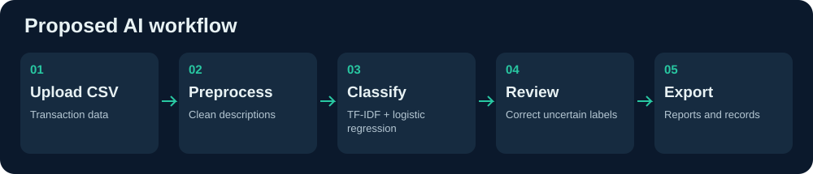
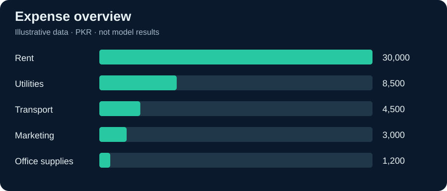
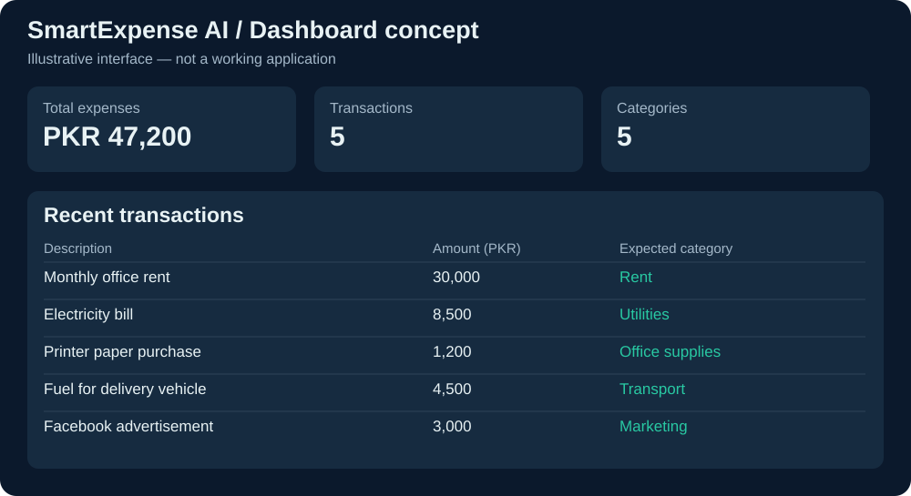

# SmartExpense AI — Intelligent Expense Categorization

**Building AI course project** · Concept proposal · Machine learning / Accounting

> My vision is to make everyday bookkeeping simpler, more consistent and easier to understand.

**Project status:** Idea stage — no trained model or measured results yet.

---

## 1. My idea in a nutshell

My project, SmartExpense AI, is a proposed tool that automatically categorizes business expenses from transaction descriptions. My aim is to reduce manual bookkeeping and help small businesses and accounting students understand spending patterns.

## 2. Background

Small businesses often record transactions manually in spreadsheets. Sorting expenses into categories such as rent, utilities, transport and office supplies can be repetitive and prone to errors. Businesses that process transactions regularly face this problem whenever they prepare their accounts.

My motivation for proposing this idea is the practical connection between artificial intelligence and accounting. I believe a simple tool could make bookkeeping more efficient without requiring expensive enterprise software.

## 3. Data and AI techniques

I plan to build a system that uses transaction descriptions and their correct expense categories from historical accounting records. Transaction amount could be an optional feature. I would anonymize the data to remove personal details and account numbers, and check labels for accuracy.

I plan to use a supervised machine learning text classifier with TF-IDF to convert descriptions into numerical features and logistic regression to predict categories. I would use a rule-based approach as a baseline. I would separate training and testing data and evaluate performance using accuracy, macro F1 and a confusion matrix. I would flag low-confidence predictions for manual review. If I use probability estimates, I would also evaluate their calibration.

### My proposed AI workflow

### Illustrative examples (synthetic, not actual records):

| Transaction description | Amount (PKR) | Expected category |
|---|---:|---|
| Monthly office rent | 30000 | Rent |
| Electricity bill | 8500 | Utilities |
| Printer paper purchase | 1200 | Office supplies |
| Fuel for delivery vehicle | 4500 | Transport |
| Facebook advertisement | 3000 | Marketing |

The five fictional transactions total **PKR 47,200**. This chart illustrates the type of spending summary I would like my system to produce; it is not a model evaluation.

## 4. How is it used?

A small business owner or bookkeeper would upload a CSV file containing expense descriptions. My proposed system would suggest a category for each transaction, flag uncertain predictions and allow the user to correct them. The reviewed results could then be exported for bookkeeping or summarized by category.

Accountants benefit from reduced repetitive work, while business owners gain a clearer view of expenses. Employees and customers whose information may appear in records also have an interest in privacy. Human review remains essential, especially for unusual transactions.

### My proposed dashboard

This mockup shows how I envision the interface. It is a static design, not a functioning application.

## 5. Challenges

- Ambiguous descriptions may lead to incorrect classifications.
- Limited or imbalanced training data may reduce accuracy.
- Different businesses may use different charts of accounts.
- Financial records require secure storage, restricted access and appropriate consent or authorization.
- The system cannot independently verify receipts, detect every fraud case, determine tax treatment or replace professional accounting judgment.

My project is currently at the idea stage. I have not trained or tested a model, and I do not claim any measured accuracy or savings.

## 6. What next?

First, I plan to create a small synthetic dataset and develop a baseline classifier. Next, I would obtain authorized, anonymized records and test the model on unseen transactions. I would consider a pilot with volunteer bookkeepers to assess usability and error rates. In the future, I would like to add multilingual descriptions (English and Urdu), receipt extraction, customizable expense categories and integration with accounting software. I would review user corrections before including them in future training data.

### My development roadmap

| Phase | My planned milestone |
|---|---|
| 1 · Explore | Prepare synthetic examples and define categories |
| 2 · Build | Develop a rule-based baseline and text classifier |
| 3 · Evaluate | Test on unseen, authorized records and analyze errors |
| 4 · Pilot | Gather feedback from volunteer bookkeepers |
| 5 · Expand | Explore Urdu support and accounting integrations |

## 7. Acknowledgments

- Building AI, Elements of AI, University of Helsinki and Reaktor — course and project framework: https://buildingai.elementsofai.com/
- scikit-learn documentation — reference for proposed machine learning methods: https://scikit-learn.org/stable/
- The transaction examples are fictional and were created for this proposal. No third-party code or datasets are included.

